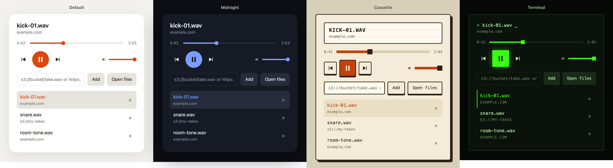
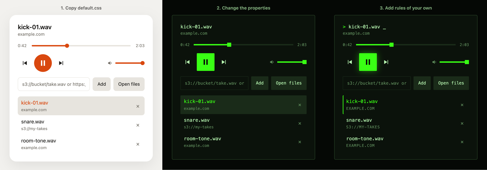
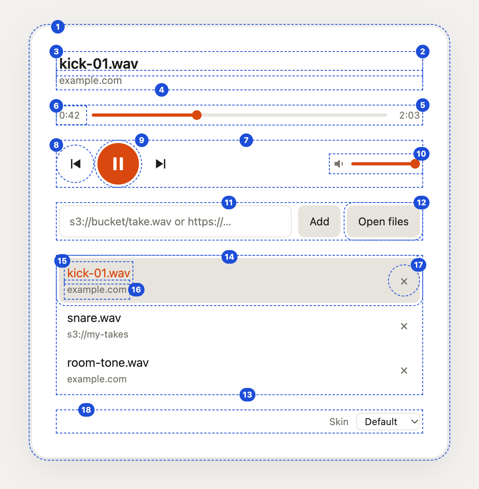
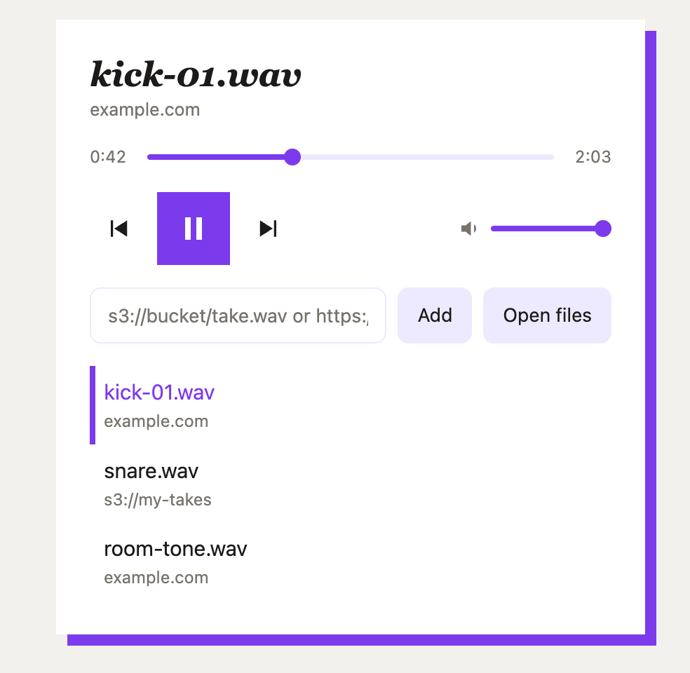

# Player

A small WAV player for the browser. It plays files from your disk and from
S3, its whole look lives in one swappable CSS file, and it embeds in any web
page with one tag. No dependencies and no build step; Node 20 or newer runs
the local server.

```sh
node server.js                      # http://localhost:4173
node server.js --dir ~/Music/takes  # also lists the WAVs in that folder
node server.js --port 8080
node --test                         # tests
```

## Playing things

| Source | How |
| --- | --- |
| Files on disk | **Open files**, or drop them on the page |
| A folder on disk | Start the server with `--dir`; its WAVs (one level of subfolders deep) fill the playlist |
| S3 | Type `s3://bucket/path/take.wav`, or paste the object's address from the AWS console, and press **Add** |
| Any web address | Type `https://…/take.wav` and press **Add** |

Space plays and pauses. Previous goes back to the start of the track first,
then to the track before.

### S3

For an S3 object the page asks the local server for a presigned address,
good for an hour, and plays that. A fresh one is signed every time the track
starts, so a playlist left open overnight still works. Your keys stay in the
server process and never reach the browser.

Any of these names the object:

```
s3://my-bucket/takes/kick.wav
arn:aws:s3:::my-bucket/takes/kick.wav
https://my-bucket.s3.us-west-2.amazonaws.com/takes/kick.wav      (the console's "Object URL")
https://us-west-2.console.aws.amazon.com/s3/object/my-bucket?…   (the object's console page)
```

What has to be in place:

1. **An object to play.** To put a test file up:
   `aws s3 cp take.wav s3://my-bucket/takes/take.wav`
2. **Credentials where the server runs.** It looks for
   `AWS_ACCESS_KEY_ID` / `AWS_SECRET_ACCESS_KEY` (and `AWS_SESSION_TOKEN`) in
   the environment, or else asks the AWS CLI, which covers `AWS_PROFILE`
   and SSO. Check with `aws sts get-caller-identity`; if an SSO login has
   lapsed, `aws sso login`.
3. **Permission.** Those credentials need `s3:GetObject` on the object, and
   `kms:Decrypt` if the bucket encrypts with a KMS key.

Nothing else: no bucket policy, no public access and no CORS rule. The
bucket's region is looked up for you; `AWS_REGION` is the fallback.

Before handing an address to the browser the server reads the first byte
itself, so when S3 refuses, the player says why (no such object, access
denied, session expired, wrong credentials, archived in Glacier) instead of
only failing to load. The same line is printed in the server's terminal.

With no credentials at all, the object is tried as a public one.

The server listens on `127.0.0.1` only and answers only to `localhost`,
because it will sign for anything your credentials can read.

## Embedding

The player is a custom element, `<wav-player>`. Put this folder on any
static host and add two lines to a page:

```html
<script type="module" src="https://your.host/player/src/element.js"></script>
<wav-player src="https://your.host/takes/kick.wav" skin="midnight"></wav-player>
```

It lives in a shadow root, so the page's CSS cannot restyle it and its CSS
cannot leak into the page. Size and place the element like any block. Several
players can share a page; starting one pauses the others.

For more than one track, put links inside. They double as the fallback when
scripts are off:

```html
<wav-player skin="cassette">
  <a href="takes/kick.wav">Kick</a>
  <a href="s3://my-bucket/takes/snare.wav">Snare</a>
</wav-player>
```

| Attribute | Meaning |
| --- | --- |
| `src` | One track: an http(s) address, relative to the page if you like, or `s3://bucket/key` |
| `skin` | A skin's name from `skins/`, or the address of your own skin sheet |
| `editable` | The listener may add and remove tracks: address box, file picker, drop |
| `skin-menu` | Show the skin menu |
| `signer` | Address of an endpoint that presigns `s3://` addresses |
| `folder` | Address of a JSON list of WAVs to load (the server's `/api/local`) |
| `page` | The player is the whole page: it fills it and remembers the skin |

`src`, `skin`, `editable` and `skin-menu` can change at any time. From
script, `element.player` is the `Player` (its events, `play()`, `seek()`
and so on) and `element.add(address or File, title)` appends a track.
Nothing plays until the listener presses play.

Where only an iframe is allowed, use `embed.html`:

```html
<iframe src="https://your.host/player/embed.html?src=https%3A%2F%2Fyour.host%2Ftakes%2Fkick.wav&skin=midnight"
        style="border:0; width:100%; max-width:460px; height:230px"></iframe>
```

`src` and `title` may repeat, one pair per track; `skin` is a skin's name;
`editable` lets the listener add tracks. A frame does not grow with its
contents, so allow about 60px of height for each track after the first.

Things to know when hosting it:

- The script is a module, so a page on another site can load it only if your
  host sends `Access-Control-Allow-Origin` for the files in `src/` and
  `skins/`. GitHub Pages, Netlify, Cloudflare Pages and jsDelivr do; on S3 or
  your own server, switch it on. The iframe needs no such header.
- Audio itself plays across sites without any header.
- On the public web there is no local server to sign S3 addresses, so an
  `s3://` track is fetched as a public object. For private audio, either give
  the player presigned `https://` addresses, or run an endpoint of your own
  that answers `GET <signer>?uri=s3://…` with `{ "url": "…" }` and name it in
  `signer`. `lib/presign.js` does the signing. `server.js` is not that
  endpoint: it is built to be reached from your own machine only.

## Skins



`skins/base.css` is layout and nothing else. Every colour, font, radius and
shadow is a custom property that a skin sets on `:host`, and a skin may add
rules of its own against the class names below. Use one with
`<wav-player skin="midnight">` or pick it in the Skin menu.

### Make your own skin



**1. Copy `skins/default.css` to `skins/terminal.css`.** It lists every
property a skin can set: ten required ones, then the optional ones with
their fallbacks.

**2. Change the properties.** This much is the whole middle picture:

```css
:host {
  color-scheme: dark;
  --page: #050805;          /* behind the player */
  --panel: #0b120b;         /* the player itself */
  --text: #b6f5b0;
  --muted: #5d8a5a;         /* times, details, placeholders */
  --accent: #39ff14;        /* play button, played part of sliders, current track */
  --accent-text: #050805;   /* icon on the play button */
  --track: #1a2b19;         /* unplayed part of sliders, quiet buttons */
  --danger: #ff6b6b;        /* error text */
  --radius: 4px;            /* corners of the player */
  --font: 14px/1.45 ui-monospace, "SF Mono", Menlo, Consolas, monospace;

  --border: 1px solid #2c4a2a;
  --button-radius: 2px;
  --field-radius: 2px;
  --track-radius: 0;
  --thumb-radius: 0;
}
```

**3. Add rules of your own** where properties are not enough. These five
lines make the right-hand picture:

```css
.player__title::before { content: "> "; color: var(--accent); }
.player[data-state="playing"] .player__title::after { content: " _"; }
.btn--main { box-shadow: 0 0 18px rgb(57 255 20 / 0.45); }
.track[aria-current="true"] { background: none; box-shadow: inset 2px 0 0 var(--accent); }
.track__detail { text-transform: uppercase; letter-spacing: 0.08em; }
```

**4. Register it** by adding `{ "name": "terminal", "label": "Terminal" }`
to `skins/skins.json`. It now shows in the Skin menu and works as
`skin="terminal"`. The standalone page remembers the choice, and
`http://localhost:4173/?skin=terminal` opens with it.

The finished file is `skins/terminal.css`. A skin need not live in this
folder: `skin="https://…/mine.css"` loads any sheet written the same way.

### Class names



Every piece has a class, for skin files, and a part name, for the page the
player is embedded in. Both are safe to rely on.

| # | Class | Part | What it is |
| --- | --- | --- | --- |
| 1 | `.player` | `player` | The panel. Carries `data-state` |
| 2 | `.player__now` | `now` | Now-playing block |
| 3 | `.player__title` | `title` | Track title |
| 4 | `.player__detail` | `detail` | Where the track is from, or the error |
| 5 | `.player__seek` | `seek` | Row with the times and the seek slider |
| 6 | `.player__time` | `time`, plus `elapsed` or `duration` | The two times |
| 7 | `.player__controls` | `controls` | Row of buttons and volume |
| 8 | `.btn` | `button`, plus `prev` or `next` | Any button |
| 9 | `.btn--main` | `toggle` | Play / pause. Holds `.icon-play` and `.icon-pause` |
| 10 | `.player__volume` | `volume` | Speaker icon and volume slider |
| 11 | `.player__add` | `add` | Address box, Add and Open files (`editable` only) |
| 12 | `.btn--text` | `text-button` | Buttons with words on them |
| 13 | `.player__list` | `list` | The playlist |
| 14 | `.track` | `track`, plus `current` on the current one | One row. The current one has `aria-current="true"` |
| 15 | `.track__title` | `track-title` | Its title |
| 16 | `.track__detail` | `track-detail` | Its source |
| 17 | `.track__remove` | `track-remove` | Its remove button (`editable` only) |
| 18 | `.player__footer` | `footer` | Skin menu (`skin-menu` only) |
| | `input[type="range"]` | `slider`, plus `seek-slider` or `volume-slider` | Both sliders. `--fill` runs `0%` to `100%` for the played part |
| | `.player__add input` | `field` | The address box |
| | `.track__play` | | The clickable part of a row, around 15 and 16 |
| | `.player__empty` | `empty` | "Drop WAV files here", shown when the list is empty |

States to style on:

- `.player[data-state="idle"]`, `"loading"`, `"playing"` or `"paused"`.
- `.player--error` while a track has failed; `.player--drop` while files are
  dragged over the player.
- `.track[aria-current="true"]` for the current track.
- Icons are inline SVG filled with `currentColor`, so `color` recolours them.

### Styling from the page, without a skin file



The page a player is embedded in can restyle it with its own CSS: set the
same custom properties on the element, and reach single pieces through
`::part()` with the part names above.

```css
wav-player {
  --accent: #7c3aed;
  --radius: 0;
  --track: #ede9fe;
  --shadow: 8px 8px 0 #7c3aed;
}
wav-player::part(title) { font-family: Georgia, serif; font-style: italic; font-size: 24px; }
wav-player::part(toggle) { border-radius: 0; }
wav-player::part(current) { background: none; border-radius: 0; box-shadow: inset 4px 0 0 #7c3aed; }
wav-player::part(track-remove) { display: none; }
```

Parts take states too: `wav-player::part(button):hover`. A part cannot reach
inside another, so a rule such as "the title inside the current track" goes
in a skin file instead.

To go further than CSS, change `src/markup.js`: `src/ui.js` finds elements
by id, and `src/player.js` knows nothing about the page, so it can drive
markup of your own.

The pictures here are taken from `docs/shots.html`; `sh docs/shots.sh`
retakes them after a change.

## Layout

```
index.html        the standalone app: one <wav-player> with everything on
embed.html        the player for an iframe, set up from the query string
src/element.js    <wav-player>, the custom element
src/markup.js     the markup inside it
src/ui.js         wires that markup to a Player
src/player.js     Player: a playlist over one <audio> element, with events
src/sources.js    turns files, folder entries and addresses into tracks
src/s3.js         s3:// parsing, shared by the page and the server
skins/            base.css, one file per skin, skins.json
docs/             the README's pictures and the page they are taken from
server.js         static files, --dir folder, /api/presign
lib/presign.js    Signature Version 4 presigning, credentials, bucket region
test/             node --test
```

## Limits

- WAV only in the pickers, since that is what this is for; the browser
  decides which WAV encodings it can decode (16- and 24-bit PCM and 32-bit
  float are fine in current browsers).
- A whole S3 bucket or prefix cannot be listed yet; add objects one address
  at a time.
